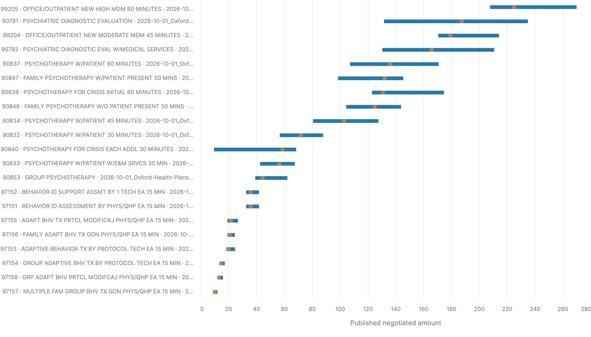

# UHC Published Price Dispersion

A small data engineering project that downloads UnitedHealthcare Transparency in Coverage files, parses nested JSON, stores the results in Snowflake, and presents one service-level price distribution chart.

**Question:** under consistent billing conditions, how dispersed are the published negotiated prices for the same service?

Both in-network (IN) and out-of-network (OON) files are ingested and modeled. The final analysis focuses on IN prices from one selected source, Optum Health Behavioral Services (OHBS). It identifies investigation leads, rather than estimating savings or recommending providers.

## Results

The final Streamlit export contains **21 service groups representing 850 source price records** from the selected OHBS file.



*Actual Streamlit chart exported on November 2, 2026. Blue intervals show the middle 50% of source prices (P25–P75); orange points show medians. Rows are ordered by median price, not by interval width. Longer intervals indicate greater absolute dispersion. Truncated labels retain source context in the application's hover details.*

### Main findings

| CPT code | Source service description | Records | P25 | Median | P75 | P75 − P25 |
|---|---|---:|---:|---:|---:|---:|
| 90791 | Psychiatric diagnostic evaluation | 29 | 131.75 | 187.45 | 235.06 | 103.31 |
| 90792 | Psychiatric diagnostic evaluation with medical services | 35 | 130.545 | 166.00 | 210.855 | 80.31 |
| 99205 | Office/outpatient new patient, high medical decision making | 21 | 207.85 | 225.17 | 270.03 | 62.18 |

1. **90791 has the widest middle-half interval among the 21 displayed groups.** Its 29 source prices have a median of 187.45, with P25–P75 spanning 103.31. Substantial dispersion remains within this service after applying the selected billing conditions.
2. **The highest median does not identify the widest interval.** 99205 has the highest median in the displayed sample, 225.17, but its interval width is 62.18. A review based only on high typical prices would prioritize differently from one focused on within-service dispersion.
3. **The spread is also visible in another diagnostic service.** 90792 has the second-widest interval, 80.31 across 35 records. Together, these two diagnostic service groups provide concrete starting points for investigating the reasons behind quote differences.

### Business interpretation

For a review focused on absolute price dispersion, start with 90791 and 90792, then examine the underlying source records and their geography, provider associations and contract terms. The output narrows an otherwise large set of published prices into a small, explainable investigation queue. It does not establish why the differences exist.

Each price record has equal weight; counts are not visits, patients or unique providers. The sample is not market-representative, and the filters do not control every contractual or geographic difference. Services have different price scales and billing units. Without utilization, quality and complete contract information, interval widths cannot be treated as achievable savings or evidence that a provider's price is unreasonable.

**Project outcome:** nested IN/OON files are modeled into traceable price records, and one reproducible SQL aggregation turns selected IN prices into an interpretable distribution chart. The delivered finding is an investigation priority, with its scope and limitations explicit.

## Pipeline

```text
Official listing → 1,000 Index files → selected 3 IN + 5 OON files
                             ↓
                 Python raw JSONL preparation
                             ↓
               Snowflake raw VARIANT tables
                             ↓
                  IN and OON price tables
                             ↓
             One IN service-dispersion result table
                             ↓
                  Streamlit in Snowflake
```

| File | Responsibility |
|---|---|
| [src/ingest.py](src/ingest.py) | Select URLs, download files and record outcomes |
| [src/io_utils.py](src/io_utils.py) | Streaming downloads, file validation, provenance and JSONL utilities |
| [src/transform.py](src/transform.py) | Package original Index documents and download snapshots |
| [src/pricing.py](src/pricing.py) | Stream service objects from compressed IN/OON files |
| [sql/01_load_raw.sql](sql/01_load_raw.sql) | Load three raw tables and define conversion helpers |
| [sql/02_build_rates.sql](sql/02_build_rates.sql) | Expand nested services into IN and OON price tables |
| [sql/03_analysis.sql](sql/03_analysis.sql) | Build the single service-dispersion result table |
| [dashboard/streamlit_app.py](dashboard/streamlit_app.py) | Read the result table and display one chart |
| [tests/test_ingest.py](tests/test_ingest.py) | Acquisition unit tests using mocked HTTP and temporary files |

## Data source and sample

Source: [UHC Transparency in Coverage](https://transparency-in-coverage.uhc.com/), using its [listing API](https://transparency-in-coverage.uhc.com/api/v1/uhc/blobs/).

Index files describe references to price files. The recorded acquisition used a saved October 2026 official listing snapshot; later live listings may not contain the same files.

Selection is deterministic:

1. Take the first 1,000 distinct `_index.json` download URLs in listing order.
2. Read their price-file references and match complete URLs to the official listing's names and declared sizes.
3. Require a positive declared size of at most 10 MiB. Choose the smallest eligible IN file for each of three source filename labels: OHBS, OHPH-ST and Acupuncture-Massage-Naturopath.
4. Choose the four largest eligible OON files and the smallest remaining OON file.

This is a convenience sample constrained by processing cost, not a representative UHC sample. Existing selection files are reused on reruns. Download tasks are deduplicated by complete URL; original Index reference occurrences remain in the raw documents.

## Table model

| Table | Row grain |
|---|---|
| RAW_INDEX_INPUT | One original Index document with source metadata |
| RAW_DOWNLOAD_INPUT | One historical download snapshot |
| RAW_PRICING_INPUT | One complete service object or one file header |
| IN_NETWORK_RATES_SQL | One source `negotiated_prices` object |
| OUT_OF_NETWORK_RATES_SQL | One provider child under a source payment, preserving its allowed/billed amount pair |
| IN_SERVICE_DISPERSION_SQL | One selected source service/expiration group with price quantiles |

`V_RAW_PRICING` is the only helper view. SQL 02 extracts IN prices along `service → negotiated_rates → negotiated_prices`. It does not expand provider references alongside prices, avoiding multiplication by provider-list size.

OON follows `service → allowed_amounts → payments → providers`. Allowed amount belongs to the parent payment; billed charge belongs to the provider child. A payment with two child charges produces two pairs, not evidence of two visits. NPI arrays are retained without expansion or external enrichment.

`FILE_KEY` is the SHA256 of the complete source URL, not a content checksum. Price keys append original array positions. Equal amounts at different source positions remain separate records. Both price tables retain the source URL and filename.

## Analysis definition

SQL 03 filters to OHBS, CPT version 2026, fee-for-service, negotiated prices, professional billing, outpatient setting, and exactly Office place-of-service code 11. It requires explicitly empty modifier arrays, additional information and severity fields, plus positive amounts. Missing values do not count as explicitly empty.

Prices are grouped by source file, source service position, code/name and expiration value. The result contains count, P25, median and P75. Groups need at least 20 records and two distinct amounts to appear. This is a display threshold, not a statistical guarantee. Continuous percentiles can interpolate between source amounts.

The result table is materialized: rerun SQL 03 when base prices change. The dashboard presents the SQL results without recalculating business metrics locally.

## Reproduce the chart in Snowflake

The bundled inputs let a reviewer reproduce the model without downloading the original UHC files. A Snowflake account with permission to create the project objects and a warehouse is required. Queries and the application use Snowflake compute.

### 1. Create the loading environment

Open `sql/01_load_raw.sql` in a SQL worksheet. Execute the initial setup through creation of `UHC_STAGE` and `UHC_RAW_JSON`. The script uses `SYSADMIN`, `UHC_DB.ANALYTICS`, and an X-Small `UHC_WH` with 60-second auto-suspend. Existing environment objects are reused.

### 2. Upload the three raw inputs

Upload these files from `sample_data/` to the **root of UHC_STAGE**, not a `raw/` subfolder:

- `indexes.jsonl.gz`
- `downloads.jsonl.gz`
- `pricing.jsonl.gz`

Do not decompress them. The CSV selections are not loaded into the raw tables.

### 3. Build the model and analysis

Execute the rest of SQL 01, including table creation, COPY statements and conversion functions. Then execute SQL 02 and SQL 03 in order. Stop on SQL errors before continuing.

`CREATE OR REPLACE` rebuilds tables rather than appending a duplicate batch. Running only raw-table creation leaves empty tables: the COPY statements must follow. The pipeline is not an atomic transaction across tables. It contains no separate SQL data-quality audit stage.

### 4. Open the chart

Create a Streamlit in Snowflake app in `UHC_DB.ANALYTICS`, using `UHC_WH`. Replace its app code with `dashboard/streamlit_app.py` and use `dashboard/environment.yml` for dependencies. Save and run. Do not add `python=3.11` as a package dependency. No local Streamlit server is needed.

If the two base price tables already exist with the current schema and inputs, only SQL 03 and the app update are required.

## Bundled input provenance

| File | Contents |
|---|---|
| indexes.jsonl.gz | 1,000 original Index documents with provenance |
| downloads.jsonl.gz | 1,008 historical ledger snapshots with project-relative local paths |
| pricing.jsonl.gz | 7,938 IN services, 8 OON services and 8 headers: 7,954 rows |
| selected_indexes.csv | Fixed selection of 1,000 Index URLs |
| selected_pricing.csv | Fixed selection of 3 IN and 5 OON URLs |

The pricing bundle is a service-only projection of prepared inputs. Top-level provider-reference lookup objects are omitted; retained service JSON lines are unchanged, including nested reference IDs. Headers count only the retained service sections. The bundle is not a full archive of the original compressed files. Ledger existence and size fields describe historical preparation checks, not files on a reviewer's computer.

## Optional: acquire the original files locally

Requires Python 3.11 or later. Public URLs must remain accessible. Run commands sequentially and continue only after success:

```bash
python3 -m venv .venv
.venv/bin/python -m pip install -r requirements.txt
mkdir -p data/metadata/discovery
cp sample_data/selected_indexes.csv data/metadata/discovery/
cp sample_data/selected_pricing.csv data/metadata/discovery/
.venv/bin/python -m src.ingest --limit 1000 --pricing-selection data/metadata/discovery/selected_pricing.csv
.venv/bin/python -m src.transform
.venv/bin/python -m src.pricing
```

Use the selection-copy commands only in a fresh working data directory. Outputs are the three GZ files under `data/stage/`; upload them to the Stage root. For fresh discovery, omit the CSV copies in a clean checkout. A live listing without enough suitable files causes a failure rather than substituting fabricated URLs.

### Recovery and memory behavior

- Downloads write chunks of up to 64 KiB to `.part`, validate size and parse JSON/GZ through EOF, then rename. Failed partial files are removed; later attempts start from zero.
- Cache reuse requires a successful ledger entry, an existing file and matching size. This does not establish content identity for an unchanged URL.
- Pricing files are parsed once for their service array. gzip decompresses on demand and ijson builds one complete service at a time.
- Peak memory still depends on the largest service. The 8 MiB output guard applies after construction/serialization; oversized individual objects require finer splitting.
- Preparation publishes outputs only after writing completes. An older final output may remain after failure and must not be mistaken for a new successful batch.

## Tests and evidence

Optional acquisition tests:

```bash
.venv/bin/python -m pytest
```

Tests cover selection, deduplication, caching, incomplete downloads, gzip truncation and failure recording using mocked inputs. They are not a Snowflake integration suite. They were not rerun during the final documentation cleanup.

The results above use the November 2, 2026 Streamlit CSV export; the chart is the corresponding supplied PNG export. They establish the displayed aggregate values, not comprehensive validation of every pipeline step or user interaction. Documentation cleanup did not rerun cloud SQL or publish the application.
